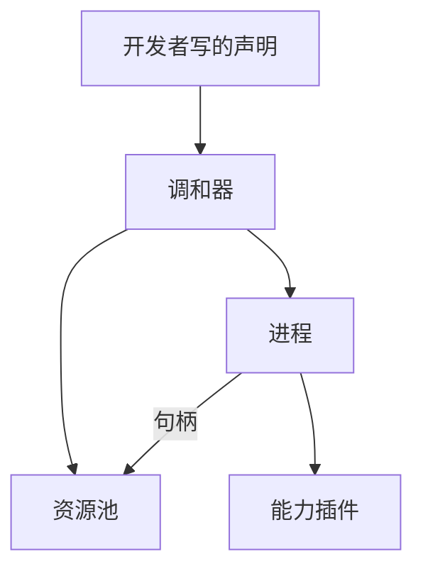

# Agent OS 进程是怎么工作的

## 核心思想

- 没有主子进程之分。能力进程彼此平级，不靠谁派生谁来拼一个智能体。
- 没有进程树。不把一个进程和它拉起的子孙收成一组一起停掉。
- 进程是分配和收回资源的基本单位。资源默认隔离，句柄是使用凭证。
- 共享是一种方法。用户先在命令行点名要共享的能力，再开多个进程。开多份只决定有几个进程；点了名的能力才共用同一份身份相同的资源。
- 声明是创建进程的唯一入口。进程加载对应插件初始化和资源装载，进程退出对应插件停止和租约归还。

- 进程之间的资源、启停和编制通过资源池的账本发生关系。业务消息走选中的通道，默认仍是账本信箱。没有从拉起方继承的管道。

操作系统在创建的那一瞬间仍会记下创建者。代码不再使用这层关系：不继承管道，不放进作业对象或进程组，也不向进程发信号。新进程仍会带上创建时的环境变量，这样它才能在 Windows 上启动。隔离靠句柄。

## 核心概念

记住这五样东西，不要混在一起：

| 名字 | 是什么 | 谁来写 |
| --- | --- | --- |
| 需求 | 这类能力需要哪一种资源，比如模型能力必须有模型 | 能力自己声明 |
| 声明 | 这次具体要哪一个，例如提供商、模型名、限额、调用参数 | 能力的档案函数给出 |
| 实体 | 池子里真正装上的那一份资源 | 系统按身份参数算出来 |
| 租约 | 这个进程占用这份实体的权利 | 资源池批准 |
| 句柄 | 进程手里的使用凭证，一张随机号码 | 池子发下来 |

几个跟着走的规则：

- 默认不共享。别人看不见你的资源，除非这个能力被点了名，池子批准并给你句柄。
- 点名之后，模型、工具、上下文都一样：身份参数相同就共用一份实体。没点名则每个进程一份。
- 身份参数（提供商、模型名）决定是不是同一份实体。`temperature` 这种调用参数留在进程里，不会变成另一份模型。
- 进程关掉，只卸掉这个进程里的插件，并归还它的租约。实体要等没有任何进程占用时才卸载。
- 创建是一步一步做完的：编译声明、一次拿下全部租约、装载实体、再启动进程。任一步失败就收回已经拿到的东西。装好了、装失败了、句柄被作废、进程退出了，都写在账本上，不用来创建进程。



一个进程里目前只装一个插件。一个智能体如果又要模型又要工具，就是多个平级进程共用一个池子。

## 现在怎么启动

不另写 JSON。进程只问能力有没有档案函数。模型插件用自己的卡片实现这个函数。要临时改模型或温度，写在启动命令后面：

```powershell
linope start model.openai_chat_model --ping model change - gpt-4o temperature change - 0.2
```

没有档案函数的能力会在创建进程之前停住，并说明没有可用档案。进程不读卡片文件，也不替能力填写身份。

要让若干能力共用同一份身份相同的资源，先点名，再开进程：

```powershell
linope share model.openai_chat_model tools.bash
linope layout numbered
linope start model.openai_chat_model 10
linope share off
```

先 `linope layouts` 查看，再用 `linope layout 名称` 选中 `numbered`、`counted` 或 `named`。然后执行 `linope start`，末尾写这次要的份数，例如 `linope start model.openai_chat_model 10`。不写就是 1。这个数字不写进账本，布局名后面也不写份数。`linope layout off` 关掉选择。没选布局时，一次启动只拉起一份；这时写大于 1 的份数会被拒绝。

## 当前实现

已经有的：

- 声明仍是创建进程的唯一入口，但由能力的档案函数给出。命令行不再读取 JSON 声明。
- 能力只声明自己需要的资源种类，不再绑定一个固定的 `*.runtime` 名字。`prompt` 单独成一种资源。
- 资源池按种类管理实体，用引用计数决定装载和卸载。账本保存在文件中，租约在一次原子更新里要么全成功要么全撤回。
- 进程只收到句柄、种类、限额和调用参数，看不到内部的实体编号。启动包写在账本里，进程自己读。
- 共享名单在账本里。点了名的能力，身份相同的资源只装一份，每个进程一张句柄。没点名的，每个进程一份。共享不会把版本号往上加。
- 可以作废一张句柄。进程下次读账本时丢掉它。账本重新打开时，会把 pid 已经不在的进程标成失败并归还租约。
- 进程自己退出时归还租约。消失了又没归还的，由账本回收。
- 插件如果提供了 `create_adapter`，启动时会 `initialize`，停止时会 `shutdown`。
- 探活和资源装入走当前选中的通信通道。没选通道时，这就是账本里的请求行。停止只把进程行的期望写成 `stop`。
- 业务通道可以换成已登记的方法。内置的是账本信箱、ZeroMQ、gRPC 和 NATS。开发者用 `register_channel` 接入自己的方法。进程仍按 `process_id` 平级通信。
- 启动装上实体：种类加身份，例如这一份模型。`linope load 能力名 种类 内容` 往已经租到的资源上装内容。这句话不进入实体身份，所以还是同一个模型。

还没有的：

- 装载器只把实体记成「已装载」，不会真的去拉模型，也不会启动工具沙箱。
- `load prompt` 会把正文交给模型插件里现有的调用函数。插件内部的实现函数还在，进程不再按那些名字调用。

## 进程内异步和线程

进程仍然是资源、租约、环境和公开通信的边界。进程内运行时采用异步优先
模型：

```text
asyncio 事件循环
├── 异步插件：直接 await
└── 同步插件：进入受限 ThreadPoolExecutor
```

线程不是进程的子 Agent，也不是新的资源主体。线程只执行同步阻塞插件；
异步模型调用在进程事件循环中等待网络，不为每条请求重复创建
`asyncio.run()`。请求认领使用 `claim_token` 和租约时间，过期执行单元不能
覆盖新认领的结果。`process_id` 仍是唯一公开身份，`thread_id` 不进入账本
寻址和资源租约。

## 服务

一个 Agent 在 `kernel/services` 里是若干平级进程的聚合。服务把规格翻译成每个成员的声明，再调用这里的调和器创建进程。副本该开谁、该关谁仍由编制决定。请求按角色送进成员信箱，挑选仍由 `kernel/load_balancing` 做。调用方只看到 `submit`、`wait`、`members` 和 `close`。
