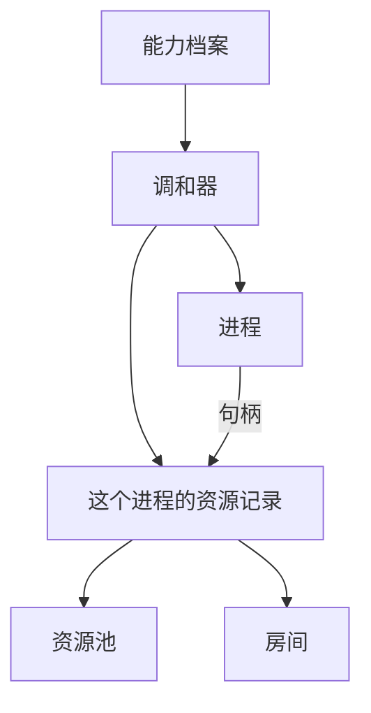

# Agent OS 进程是怎么工作的

## 核心思想

- 没有主子进程之分。能力进程彼此平级，不靠谁派生谁来拼一个智能体。
- 没有进程树。不把一个进程和它拉起的子孙收成一组一起停掉。
- 进程是分配和收回资源的基本单位。一个操作系统 `pid` 一份资源记录。线程和服务都不是资源主体。
- 档案和资源契约只说明一种资源允不允许共用。这次要不要共用，由启动命令的 `--share` 点名。不点名就一人一份。
- 声明是创建进程的唯一入口。档案函数给出这次要领的资源。进程退出时关闭这份记录并归还租约。

操作系统在创建的那一瞬间仍会记下创建者。代码不再使用这层关系：不继承管道，不放进作业对象或进程组，也不向进程发信号。新进程仍会带上创建时的环境变量，这样它才能在 Windows 上启动。隔离靠句柄和这份记录。

## 核心概念

记住这五样东西，不要混在一起：

| 名字 | 是什么 | 谁来写 |
| --- | --- | --- |
| 需求 | 这类能力需要哪一种资源，比如模型能力必须有模型 | 能力自己声明 |
| 声明 | 这次具体要哪一个，例如提供商、模型名和调用参数 | 能力的档案函数给出 |
| 实体 | 池子里真正装上的那一份资源 | 系统按身份参数算出来 |
| 租约 | 这个进程占用这份实体的权利 | 资源池批准，并写进该进程的记录 |
| 句柄 | 进程手里的使用凭证，一张随机号码 | 池子发下来 |

资源只有五种：`memory`、`tool`、`sandbox`、`model`、`network`。规矩在 `kernel/resource/resource_contract.py`。句柄上没有限额。目录能不能读写写在房间里，不是一种资源。

几个跟着走的规则：

- 默认独占。两个进程即使申请了同一个模型，也是两份实体、两份记录。
- `--share model` 并且两边身份相同，才是一份模型实体、两本账。点了模型不会把记忆也变成同一份。
- 身份参数（提供商、模型名）决定是不是同一份实体。`temperature` 留在 `call_params`，不会变成另一份模型。
- 关掉的是这一份记录。记录上的租约都退回。某个实体要等没有任何记录占用时才卸载。
- 创建顺序是：先拿到操作系统 pid，再开一份空记录，按申请写入租约，用记录配出房间，最后标成就绪。任一步失败就丢掉这份记录。



一个进程里目前只装一个插件。一个智能体如果又要模型又要工具，就是多个平级进程，各自一份记录。

## 现在怎么启动

不另写 JSON。进程只问能力有没有档案函数。模型插件用自己的卡片实现这个函数。要临时改模型或温度，写在启动命令后面：

```powershell
linope process start model.openai_chat_model --change model=gpt-4o --change temperature=0.2
```

没有档案函数的能力会在创建进程之前停住，并说明没有可用档案。进程不读卡片文件，也不替能力填写身份。

启动多份，以及只让模型共用：

```powershell
linope process start model.openai_chat_model --count 2 --share model
```

不写 `--count` 就启动一份。不写 `--share`，即使契约允许共用，也仍然一人一份。不写 `--once` 就一直留着；写了 `--once`，这一次做完就关闭记录并退出。

## 当前实现

已经有的：

- 声明由能力的档案函数给出。命令行不再读取 JSON 声明。
- 五种资源登记在资源契约里。表上没有的名字，申请时打回。
- `kernel/process/reconcile.py` 先打开 `ProcessResourceRecord`，再绑定租约。句柄从这份记录裁出来。
- 活着时记录在内存里。给出账本路径时，`kernel/process/ledger.py` 把同一张表写进一个文件。模型回复和文件正文不进这张表。
- 进程只拿到句柄、种类和 `call_params`，看不到实体编号。
- `CapabilityProcess.stop` 关闭这份记录并退租。`ProcessReaper` 在进程已死时关闭记录。
- 启动命令停在拉起它的那个 Python 进程里，打印操作系统 `pid` 后等待。它不脱离拉起方，也不进入 `process_runtime` 的请求循环。
- `--ping` 问这个进程自己并核对序号。它回 `pong`，不调用模型。没答、序号不对、或者不是这个 `pid`，都算没答。
- 进程留着时，`load <种类> -- <内容>` 交给已经打开的适配器。模型用 `message`，工具用 `tool`。
- 两个进程可以共用同一份 memory，也可以只把一件事交给对方。共用时，`--share memory` 让他们拿着同一份 memory。`system`、人说的话、模型输出、工具输出和交回来的结果都写在这份 memory 里，存在内存中。谁写进去，另一个读同一份的也能看见。只交任务时，对方看不到发送方的 memory，做完的结果写回发送方的 memory。
- 进程眼下在干什么，记在活动里：闲着是 `sleeping`，自己干是 `self`，跟另一个进程一起干是 `with`。交任务时，方式记成 `task`。停掉是 `closed`。页面上如果还有别的活着的进程拿着同一份 memory，会多一个 `share` 链接指向它。

还没有的：

- 装载器只把实体记成「已装载」，不会真的去拉模型连接，也不会启动工具沙箱。真正调用发生在之后的 `load`。
- 问询可以沿进程申请的通道送出。现在没有把这句话送到另一台机器的程序，所以远处不回就是超时。

## 进程内异步和线程

进程仍然是资源、租约、环境和公开通信的边界。`kernel/thread` 准备的运行方式是：

```text
asyncio 事件循环
├── 异步插件：直接 await
└── 同步插件：进入已有的 WorkerPool
```

线程不是进程的子 Agent，也不是新的资源主体。线程使用所属进程已经发下的句柄，不另建记录。操作系统 `pid` 仍是唯一公开身份，`thread_id` 不进入账本。

## 服务

服务是若干已经在跑的进程的名单，自己不是进程。`linope service start <进程号> [<进程号> ...]` 核对进程账本后把这些号记下来。启动进程仍由 `process start` 交给进程调和器，每个进程有自己的进程号和资源记录。
