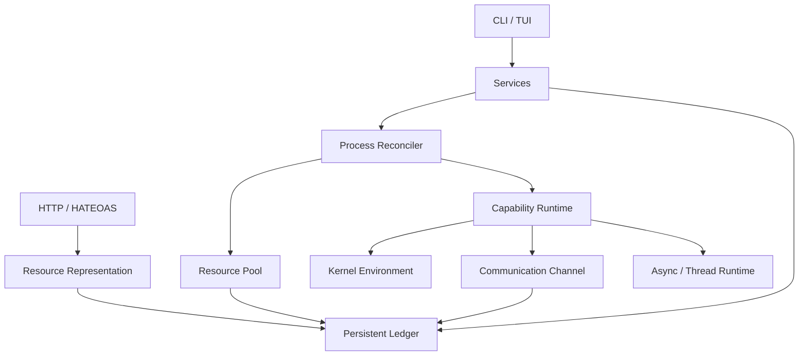

# Linope Kernel：面向平级智能体的资源导向型运行时内核

## 摘要

多数 Agent 框架将模型调用、工具编排和上下文处理放在同一逻辑运行时中；部分系统虽然支持 Worker、MCP 或 Sandbox，但通常没有将主动能力、被动资源和状态转移统一为同一种运行时模型。

Linope Kernel 从传统系统内核的角度构建 Agent 运行环境：将模型、工具和其他主动能力实现为彼此平级的 capability process，将上下文、工作区、网络和通信等能力建模为可声明、可租用和可回收的资源。进程之间不依赖固定的主从树，而是通过资源声明、资源租约、句柄、持久化账本和通信通道完成协作。

Linope 当前支持 `context`、`memory`、`workspace`、`tool`、`network` 和 `communication` 等资源类型，并通过资源身份、共享模式、引用计数和 fencing token 管理生命周期。资源表示通过 HTTP HATEOAS 暴露可用关系，使资源当前状态决定客户端能够执行的下一步操作。

本文介绍 Linope Kernel 的设计思想、系统架构、资源模型、进程模型、账本机制、HATEOAS 状态转移以及进程故障处理机制，并讨论当前实现的限制和未来发展方向。

## 1. 引言

随着大语言模型能力不断增强，Agent 系统逐渐从一次性的问答程序发展为能够调用工具、读写文件、执行命令、访问网络并持续运行的复杂系统。

传统 Agent 框架通常将 Agent 表示为一个包含以下内容的对象：

```text
Agent
 ├── Model
 ├── Tools
 ├── Memory
 ├── Prompt
 └── Subagents
```

这种结构适合快速构建应用，但存在三个问题。

第一，Agent、工具、模型和上下文通常耦合在同一个运行时中，资源共享和隔离边界不清晰。

第二，多 Agent 系统普遍使用主 Agent、子 Agent 或任务树描述关系，导致生命周期、权限和故障传播容易绑定在一起。

第三，模型上下文通常被处理为一段静态消息，而不是一种需要分配、限制、换出和恢复的运行时资源。

Linope Kernel 的目标是将 Agent 运行时拆分为：

```text
能力进程
资源租约
持久化账本
通信通道
环境权限
超媒体状态
```

它关注的不是“如何让模型思考”，而是：

> Agent 如何获得资源、使用资源、共享资源，并在部分进程失效后继续运行。

## 2. 项目定位

Linope 当前更接近“面向 Agent 的运行时内核”，而不是完整的通用操作系统。

它已经具备部分内核特征：

- 资源分配和回收；
- 资源租约和句柄授权；
- 进程创建和生命周期管理；
- 进程间通信；
- 请求调度和负载均衡；
- 文件系统和执行环境限制；
- 持久化运行账本。

它还提供部分操作系统用户态能力：

- CLI 和 TUI；
- 服务创建与调用；
- HTTP 资源服务；
- 模型与工具能力接入；
- HATEOAS 资源表示。

当前还没有完全实现成熟操作系统所具备的内核级隔离、设备和驱动体系、统一系统调用、持续监督器以及完整的自动故障转移。

因此，本文将 Linope 定义为：

> 面向平级 AI Agent 的资源导向型运行时内核。

## 3. 设计目标

### 3.1 平级能力进程

能力进程之间不建立业务层面的主从关系。

一个模型、工具或上下文能力可以运行在独立进程中。进程通过公开的 `process_id` 通信，而不是通过父子进程管道通信。

服务只是进程之间的成员关系，不代表进程所有权。一个进程可以属于多个服务，也可以在解除服务绑定后继续运行。

操作系统仍然存在创建者和被创建进程，但 Linope 不把操作系统层面的创建关系作为业务调度、权限、通信和资源生命周期的依据。

### 3.2 资源导向

能力进程不直接拥有模型、工具、上下文和工作区，而是通过资源声明申请资源。

资源具有：

- 资源类型；
- 资源身份；
- 资源租约；
- 资源句柄；
- 资源限额；
- 使用量；
- 生命周期；
- 共享模式。

因此，Agent 的运行时能力可以被声明、租用、共享和回收。

### 3.3 账本作为事实来源

进程状态、资源租约、通信请求、服务关系和资源页面共同保存在账本中。

账本支持：

- 本地 JSON 文件；
- 数据库存储；
- 内存存储；
- 分段保存；
- 原子文件替换；
- 进程间文件锁；
- 进程死亡后的租约回收。

账本不是模型配置文件，而是系统运行过程中的控制状态。

### 3.4 表示驱动的状态转移

客户端不预先假设资源下一步可以执行什么操作，而是读取服务器返回的 `_links`。

资源当前状态决定当前菜单。例如：

```text
resident
 ├── content
 ├── pin
 └── swap

pinned
 └── content

swapped
 └── admit
```

客户端只跟随当前表示中存在的关系。

## 4. 总体架构



主要模块职责如下：

- `kernel/resource`：资源定义、资源编译、租约、句柄和资源池；
- `kernel/process`：进程创建、启动、停止、运行和故障回收；
- `kernel/services`：将平级进程编组为服务；
- `kernel/communication`：实现账本、ZeroMQ、gRPC 和 NATS 通信；
- `kernel/environment`：提供文件、shell、网络、内存和计算权限；
- `kernel/thread`：处理异步请求和同步阻塞任务；
- `kernel/hypermedia`：提供资源表示和 HATEOAS 状态转移；
- `kernel/load_balancing`：根据资源使用情况和信箱负载选择进程；
- `kernel/database`：将整本账本保存到数据库。

## 5. 核心机制

### 5.1 资源身份

Linope 使用资源类型和资源身份生成资源实体编号。

共享资源的身份主要由以下信息决定：

```text
resource_kind + resource_identity
```

非共享资源还会加入进程编号：

```text
resource_kind + resource_identity + process_id
```

调用参数不参与资源实体身份计算。例如，模型身份决定是否为同一模型资源，而 temperature 等参数属于调用设置。

这种设计将资源实体和一次调用的参数分离开来：

```text
资源实体：决定资源是否相同
调用参数：决定这次如何使用资源
```

### 5.2 资源租约与句柄

进程不会直接获得资源内部编号，而会获得一个资源句柄。

资源池负责：

1. 编译资源声明；
2. 检查资源是否可以共享；
3. 获取资源租约；
4. 加载资源实体；
5. 生成进程句柄；
6. 在进程退出时释放租约；
7. 在句柄作废后拒绝继续访问。

fencing token 用于阻止旧进程或旧句柄在资源重新分配后继续写入。

### 5.3 进程创建流程

一个能力进程的创建过程如下：

```text
能力声明
  ↓
读取能力定义
  ↓
编译资源声明
  ↓
登记进程
  ↓
资源池获取全部租约
  ↓
加载资源实体
  ↓
生成启动包
  ↓
启动独立进程
  ↓
进程初始化环境和插件
  ↓
进程进入运行状态
```

如果中间任何步骤失败，系统会释放已经取得的资源，避免产生半完成的进程。

当前的 `RecordingLoader` 主要用于记录资源装载状态，还不会真正加载模型权重或启动工具沙箱。因此资源装载器仍属于后续实现重点。

### 5.4 请求执行流程

请求处理过程如下：

```text
提交请求
  ↓
写入 mailbox
  ↓
预定资源和进程
  ↓
进程原子认领请求
  ↓
生成 claim_token
  ↓
异步或线程池执行
  ↓
检查租约和依赖仍然有效
  ↓
提交结果
```

请求认领具有租约时间。认领过期后，请求可以重新进入等待状态。旧执行单元不能使用过期的 claim token 覆盖新执行结果。

### 5.5 HATEOAS 资源状态

文件资源通过 HTTP 返回资源表示：

```json
{
  "type": "file",
  "id": "opaque-id",
  "state": "resident",
  "_links": {
    "self": {
      "href": "http://127.0.0.1:49152/resources/opaque-id",
      "method": "GET"
    },
    "content": {
      "href": "http://127.0.0.1:49152/resources/opaque-id/content",
      "method": "GET"
    },
    "pin": {
      "href": "http://127.0.0.1:49152/resources/opaque-id/pin",
      "method": "POST"
    },
    "swap": {
      "href": "http://127.0.0.1:49152/resources/opaque-id/swap",
      "method": "POST"
    }
  }
}
```

HATEOAS 在 Linope 中不仅用于 REST 风格的 API，也用于表达：

- 内容是否当前可见；
- 内容是否占用上下文；
- 页面是否可以换出；
- 页面是否可以固定；
- 工具是否已经租用；
- 工具结果是否会占用新的资源页面；
- 当前资源是否允许压缩。

这使上下文管理从静态字符串管理转变为资源状态管理。

## 6. 上下文资源模型

Linope 将工具结果分为三类：

- `LINK`：返回链接，不立即占用上下文；
- `OCCUPY`：跟随后可能产生新的上下文页面；
- `SYSTEM`：压缩和窗口管理等系统能力。

例如，搜索结果默认只是链接。客户端真正跟随后，内容才进入当前上下文。如果工具结果带有 `keep: true`，系统才会为它创建新的长期页面。

该设计试图解决传统 Agent 中的一个问题：所有工具输出都直接拼接到 prompt，导致上下文增长不可控。

Linope 的目标是让上下文具有类似内存系统的行为：

```text
内容进入上下文
  ↓
占用窗口
  ↓
固定或换出
  ↓
压缩
  ↓
通过链接恢复
```

## 7. 进程故障处理

当进程异常退出时，Linope 通过进程身份检查判断 PID 是否仍然对应原进程。

系统可以检查：

- PID 是否存在；
- 进程启动身份是否匹配；
- 进程状态是否仍为 running；
- 进程是否拥有有效资源租约。

发现进程死亡后，系统会：

```text
释放该进程的资源租约
减少资源引用计数
卸载无人使用的资源
标记进程为 failed
阻止该进程继续接收新请求
```

因此，一个能力进程的死亡不会直接破坏其他平级进程。

但当前实现属于资源回收和故障隔离，还不是完整的自动故障转移系统。当前尚未完全实现：

- 持续 watchdog；
- 自动重启；
- 死进程请求自动迁移；
- exactly-once 工具执行；
- 所有状态的统一事件重放。

此外，进程已经死亡但仍绑定在该进程上的旧请求，不一定能够自动迁移到其他进程。正式报告中应将“资源恢复”和“请求恢复”明确区分。

## 8. 当前实现状态

### 8.1 已实现

- 平级 capability process；
- 资源声明和资源编译；
- 独占与共享资源；
- 资源租约和句柄；
- fencing token；
- 文件账本；
- 数据库存储接口；
- mailbox 请求；
- claim token 和认领租约；
- async-first 进程运行时；
- ledger、ZeroMQ、gRPC 和 NATS 通道；
- workspace 和文件权限；
- 文件资源 HTTP 服务；
- resident、pinned、swapped 页面状态；
- HATEOAS 链接菜单；
- 工具的 link/occupy/system 分类；
- 进程死亡后的资源回收。

### 8.2 尚未完成

- 所有运行时对象统一资源化；
- 完整 Agent OS；
- 自动进程重启；
- 完整请求级故障转移；
- 通用声明式状态机；
- 完整的资源装载器；
- append-only 事件日志和完整状态重放；
- HATEOAS 并发更新的版本控制。

## 9. 与相关项目的比较

DeepSeek Harness 以插件、Agent 和 Session event log 为核心，强调插件化、可重放会话和主从式子 Agent 生命周期。

LangGraph 以图和 checkpoint 为核心，重点是工作流状态转移。

Chidori 以 side-effect recording、replay 和 durable execution 为核心。

AIOS 和 OpenFang 更强调 Agent Operating System 的整体形态。

Linope 的主要区别在于：

```text
平级能力进程
+ 资源租约
+ 进程级环境
+ 持久化账本
+ HATEOAS 状态表示
```

因此，Linope 更适合被定位为：

> Agent 运行时的资源和进程内核，而不是单纯的 Agent 编排框架。

## 10. 局限性与未来工作

未来工作包括：

1. 将主要运行状态统一为声明式状态机；
2. 让状态菜单由状态定义自动生成；
3. 为资源转移加入版本号、ETag 或 CAS；
4. 实现持续进程监督器；
5. 实现进程自动重启；
6. 将死进程请求重新调度到平级进程；
7. 将账本升级为可选的 append-only event log；
8. 完善模型、沙箱、终端和网络资源装载器；
9. 建立故障注入和性能基准；
10. 测量上下文换出、压缩和资源共享带来的实际收益。

## 11. 实验设计

### 11.1 进程故障实验

实验步骤：

1. 启动三个相同的能力进程；
2. 让它们共享同一份资源；
3. 向服务提交多个请求；
4. 强制杀死其中一个进程；
5. 重新提交请求；
6. 重新打开账本；
7. 检查资源引用计数、租约、句柄和服务成员；
8. 检查旧请求是否迁移、重试或失败；
9. 检查旧进程是否还能提交结果。

建议指标：

- 死进程发现时间；
- 资源回收时间；
- 新请求成功率；
- 旧请求恢复率；
- 共享资源重复装载次数；
- 旧句柄写入被拒绝的比例。

### 11.2 HATEOAS 并发实验

实验步骤：

1. 两个客户端同时读取同一个资源；
2. 客户端 A 执行 `pin`；
3. 客户端 B 使用旧表示执行 `swap`；
4. 检查服务端最终状态；
5. 重复执行多组并发操作。

需要验证：

- 过期关系是否被拒绝；
- 是否存在 lost update；
- 状态转移是否需要 ETag 或版本号；
- HTTP 响应是否始终对应最新表示。

### 11.3 上下文占用实验

比较以下三种策略：

```text
所有工具结果直接写入上下文
搜索结果只返回链接
搜索结果返回链接，并由 keep 决定是否占用
```

建议指标：

- 单次请求 token 数；
- 多轮对话累计 token 数；
- 上下文溢出次数；
- 压缩后的信息保留率；
- 任务完成率；
- 平均响应延迟。

## 12. 结论

Linope Kernel 试图改变 Agent 系统的基本抽象。

在 Linope 中，Agent 不是一个拥有所有能力的中心对象，而是一个使用资源的平级能力进程。模型、工具、上下文、工作区、网络和通信不再只是 Agent 的内部字段，而是可以被声明、租用、共享和回收的运行时资源。

通过持久化账本，Linope 将资源状态、进程状态、请求状态和服务关系统一保存。通过 HATEOAS，资源当前状态直接决定客户端可以执行的下一步操作。

当前 Linope 还不是完整的 Agent 操作系统，但已经形成了一个具有明确边界的资源导向型 Agent 内核原型。

其核心思想可以概括为：

> **智能体保持平级，能力通过资源租约获得，状态通过超媒体关系推进。**

## 参考资料

- `kernel/resource/README.md`
- `kernel/process/README.md`
- `kernel/hypermedia/README.md`
- `kernel/communication/README.md`
- `kernel/environment/README.md`
- [DeepSeek Harness Architecture](deepseek-harness-master/docs/architecture.md)
- [AIOS](https://github.com/agiresearch/AIOS)
- [LoopX](https://github.com/loopx-project/loopx)
- [Chidori](https://github.com/ThousandBirdsInc/chidori)
